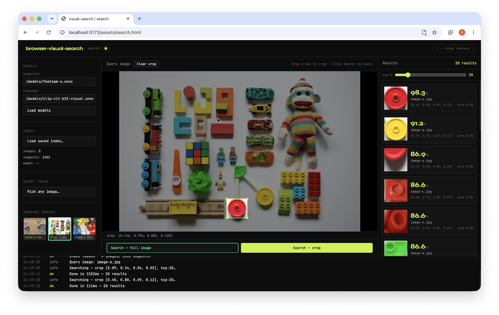

# Browser Visual Search

In-browser visual search powered by FastSAM, CLIP, ONNX Runtime Web, and the File System Access API.



## Quick start

```bash
npm install browser-visual-search
```

```ts
import { buildFromDirectory, openIndex } from 'browser-visual-search';

const dirHandle = await window.showDirectoryPicker({ mode: 'readwrite' });

const index = await buildFromDirectory(dirHandle, {
  segmenterUrl: 'https://huggingface.co/aboutgeo/immarkus/resolve/main/fastsam-s.onnx',
  embedderUrl: 'https://huggingface.co/aboutgeo/immarkus/resolve/main/clip-vit-b32-visual.onnx',
  onProgress: (p) => console.log(p),
});

// Load a previously built index
const savedIndex = await openIndex(dirHandle, {
  embedderUrl: 'https://huggingface.co/aboutgeo/immarkus/resolve/main/clip-vit-b32-visual.onnx',
});

// Query by file or region:
const results = await savedIndex.query(file, [0.1, 0.1, 0.5, 0.5], { topK: 20 });
// -> [{ imageId, normalizedBounds, pxBounds, area, score }, ...]
```

The index is persisted automatically to `.visual-search/` inside the chosen directory. Subsequent `buildFromDirectory` calls are incremental — only new images are processed.

## Requirements

This library uses the File System API and experimental browser features not yet available on all browsers. Requirements:

- Browsers with `window.showDirectoryPicker()` support
- A user-selected directory handle from the File System Access API
- Model URLs available over HTTPS (or a browser cache that already contains them)

If you are embedding this in a web app, make sure your page is served from a secure origin or an environment that supports the browser filesystem APIs.

## Models

The package is tested to work with the following ONNX models, available on [HuggingFace](https://huggingface.co/aboutgeo/immarkus/tree/main):

- FastSAM segmenter: `https://huggingface.co/aboutgeo/immarkus/resolve/main/fastsam-s.onnx`
- CLIP embedder: `https://huggingface.co/aboutgeo/immarkus/resolve/main/clip-vit-b32-visual.onnx`

You can also build and host your own models: see [scripts/README](./scripts/README.md) for instructions.

## Development

```bash
npm install
npm start
```

Point your browser to:

- `http://localhost:5173/assets/test.html` - open a folder, build an index
- `http://localhost:5173/assets/search.html` - load a saved index and run visual queries

## Testing

```bash
npm test
```

The Vitest browser tests run in Playwright and expect model files under `/assets/models/`.

## Notes

- `buildFromDirectory` is incremental for new or missing images.
- `openIndex` expects the directory to already contain a valid `.visual-search` index.
- If you want to rebuild from scratch, remove the `.visual-search/` directory or use a fresh directory handle.